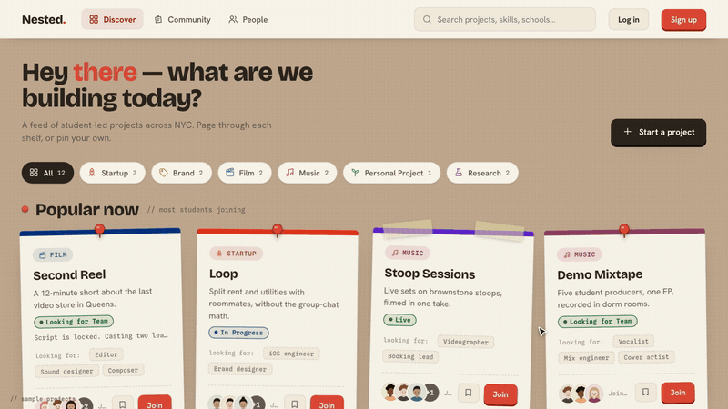
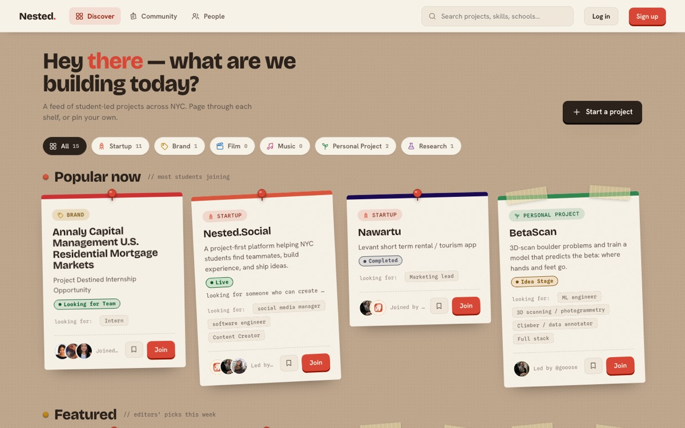

# Nested NYC

Student-only project network for NYC universities — live at **[nested.social](https://nested.social)**.

[](docs/nested-launch.mp4)

*A 44-second launch film; click it for the full video. It uses sample projects so that no real student appears in it. The numbers at the end are real.*



Students discover projects, post their own, find teammates, and follow student clubs. Signing up requires an email address from one of 18 supported NYC universities.

## Status

In soft launch since June 2026. As of November 2026, more than 150 students have signed up, nearly all of them at Pace University, with 15 projects and 9 student-run clubs on the board.

## What is in here

- **Discover board.** Projects are pinned up as flyers. Owners open roles and approve join requests.
- **Direct messages.** Every write goes through a database function, so block checks and rate limits cannot be skipped. Message bodies are encrypted at rest. Attachments and read receipts are supported.
- **Clubs and events.** Students found and follow clubs. Organizations can post events with RSVP questions; the events tab is switched off in the UI for now (`SHOW_EVENTS` in `src/config/features.js`).
- **Community board**, notification emails, and a weekly digest sent by a Vercel cron job.
- **Access rules in the database.** Row-level security decides what guests, students and organizations can read and write, and a database function enforces the university-domain allowlist at signup.
- **Pages search engines can read.** Project and organization pages are prerendered with their own titles and metadata, and the sitemap is generated from live data.

## Development

```bash
npm install
npm run dev
```

The app runs at `http://localhost:5173`.

### Supabase setup

1. Create a project at [supabase.com](https://supabase.com)
2. Copy the env template and add your project URL + anon key:
   ```bash
   cp .env.example .env
   ```
3. Apply the SQL in `supabase/migrations/` in order

## Build

```bash
npm run build
```

## Tests

```bash
npm test           # 144 unit tests (node --test, every *.test.js)
npm run test:db    # SQL acceptance proofs — needs the local Supabase stack (supabase start)
```

GitHub Actions runs the unit tests, the production build and a syntax check on every push (`.github/workflows/ci.yml`), and applies every migration to a fresh Postgres + runs the SQL proofs when `supabase/` changes (`db.yml`). Vercel runs `npm test` (the unit tests) before every build, so a red unit test never deploys; the Actions workflows are checks, not deploy gates.

## Tech stack

- React 18 + Vite 7
- Supabase (Postgres, Auth, Storage, RLS, Realtime), 76 SQL migrations
- Vercel
